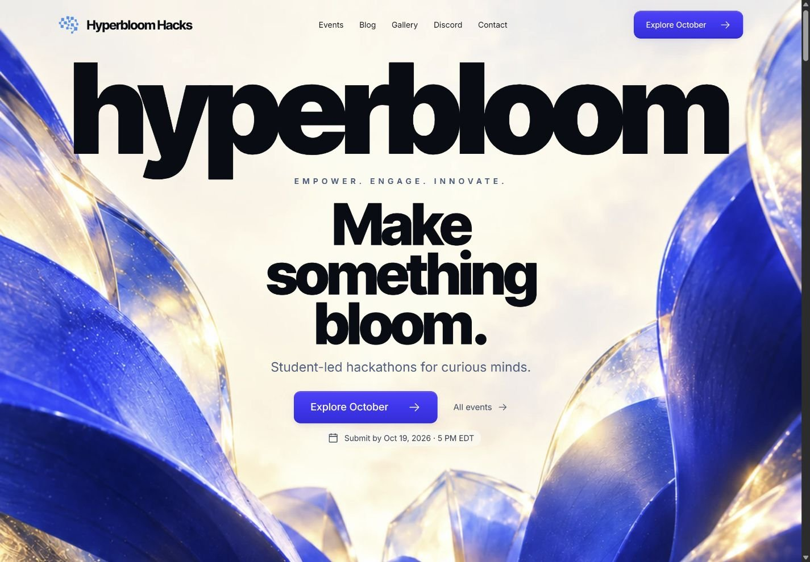
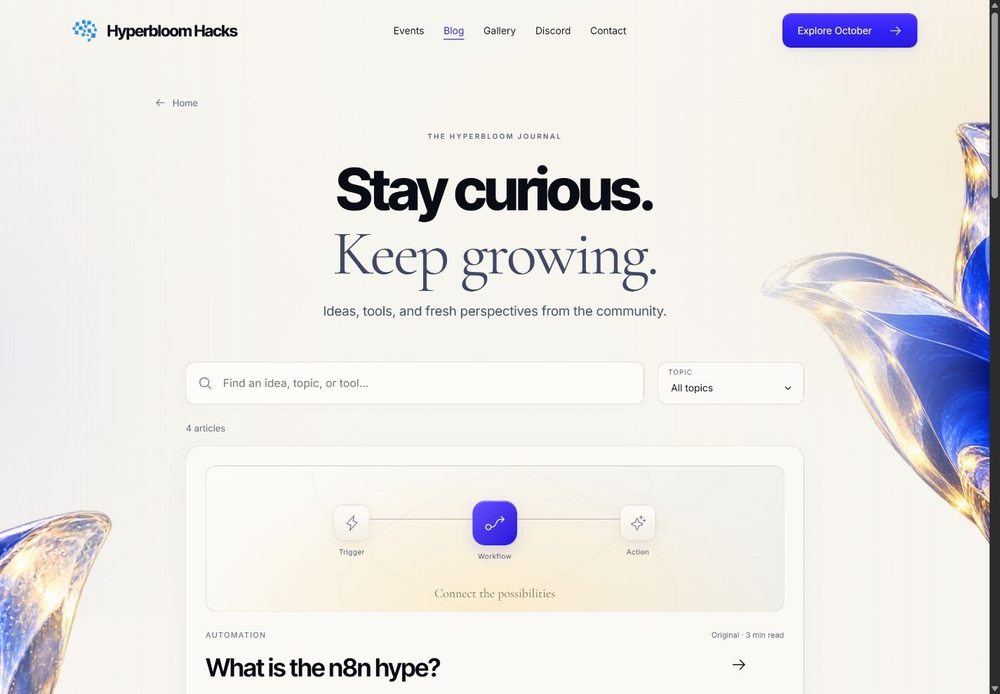

# Hyperbloom — Inside the Bloom

A cinematic, responsive redesign of [Hyperbloom Hacks](https://www.hyperbloomhacks.com/), created for the Hyperbloom October UI/UX and Web Design hackathon. An unfolding cast-glass bloom carries visitors from the current challenge through the community, events, journal, people and contact paths.

**[Live website](https://hyperbloom-bloom-2026.web.app/)** · **[Hackathon](https://hyperbloom-october.devpost.com/)** · **[Asset credits](ASSETS.md)** · **[Testing](docs/TESTING.md)**

**Independent design mockup by Victor Velazquez.** Victor does not own Hyperbloom Hacks. This project is not affiliated with, sponsored by or endorsed by Hyperbloom or the organizations shown. Original branding, content and third-party marks belong to their respective owners. See the [Terms, project disclaimer and privacy notice](https://hyperbloom-bloom-2026.web.app/terms). Public source access does not grant rights to third-party assets; no blanket license is applied to them.



## Design and experience

- A layered, reversible bloom opens with native scrolling. The text and actions stay readable and available throughout.
- One consistent ivory, cobalt and gold environment continues into later chapters and secondary pages.
- Seven genuine past partners appear immediately after the current challenge in a sliding ribbon with pause, hover/focus suspension and a stationary keyboard-accessible view.
- A clear vertical reading path, deliberate typography, restrained button feedback and a stable navigation system support the visual story.
- Mobile layouts, visible keyboard focus, skip links, system reduced-motion support and a persistent motion preference are included.

## What works

The site preserves the six original events and destinations, four benefits, three factual team profiles, seven partner links, four blog entries and the genuine V1 gallery with both original video recordings. The event archive has filters and a deadline calendar. The local journal supports search and topics; each concise local reading guide links prominently to its complete original article. The gallery has media dialogs and direct chapter links. FAQ, contact, closed-event and missing-page paths work locally and through direct URLs.

**Service boundaries:** Devpost remains the actual registration and submission service. Full original articles, author profiles, member conversations and live chat remain on the official Hyperbloom site. This frontend does not simulate accounts, submissions, comments or chat messages. The recordings stream from their original public URLs and require an internet connection. Their source does not supply captions or transcripts.



## Run and verify

Use Node.js 22.12 or newer; the release was checked on Node.js 24.15.0.

```sh
npm ci
npm run dev -- --host 127.0.0.1 --port 4173
```

```sh
npm test
npm run build
npm run check:release
npm run check:live
npm run preview -- --host 127.0.0.1 --port 4174
```

The release check verifies built asset references, dynamic partner assets, the Hosting public directory, SPA fallback, and absence of development/private files from the public build. All 25 automated tests pass. Browser checks cover phone, tablet and desktop layouts, navigation, filters/search, guide refresh, media playback, carousel controls, motion reversal, pause and dialog focus return. See [testing details and limits](docs/TESTING.md).

The public Firebase deployment also passed an [independent live check](docs/LIVE-CHECK.md): 11 direct routes and 64 assets, with deployed asset bytes matching the tested build. `npm run check:live` can repeat that check after building locally.

## Deploy to Firebase Hosting

The dedicated Firebase project is `hyperbloom-bloom-2026`. Only the compiled frontend in `dist/client` is published. SPA rewrites support direct visits and refreshes on Blog, article, Gallery and recovery routes. Hashed build assets use immutable caching while HTML revalidates.

```sh
npm run build
npm run check:release
firebase deploy --only hosting --project hyperbloom-bloom-2026
```

The original `.openai/hosting.json`, worker and packaging tests are retained as an alternative packaging target; Firebase Hosting uses `firebase.json`.

## Built with

React 19, Vite 6, CSS and requestAnimationFrame motion, Phosphor Icons, self-hosted Inter / Inter Tight / Cormorant Garamond / Instrument Serif, and purpose-made ImageGen bloom artwork. AI-assisted development was used. Original brand and event media are credited in [ASSETS.md](ASSETS.md).

This is an **independent redesign concept**, not the official organizer website or an organizer endorsement.
