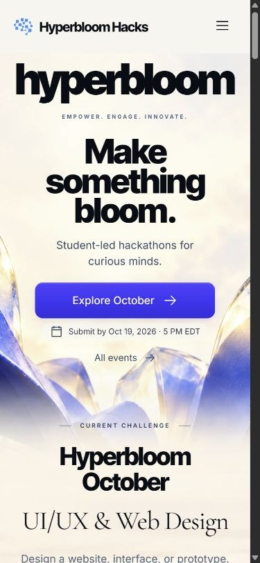

# Public release verification

Verified October 19, 2026, before the 5 PM EDT submission deadline.

**Website:** https://hyperbloom-bloom-2026.web.app/

**Repository:** https://github.com/DaDocterTaco/hyperbloom-inside-the-bloom

## Result

- 25 automated tests passed; production build and release checks passed.
- 11 public direct-route requests returned the current application shell, including all four reader URLs and the missing-page recovery.
- 64 deployed assets matched the exact local build bytes, including the hero fallback, dynamically assembled partner marks, fonts and deadline calendar. No asset request fell through to the HTML rewrite.
- HTML revalidates; hashed bundles have immutable caching.
- The repository is public and its main branch is pushed independently of the neighboring workspace projects.

## Live browser checks

The homepage renders its original six events and seven partners with no broken visible images. The challenge action retains the real Devpost URL. The partner ribbon pauses and expands into its stationary seven-link view on keyboard entry.

Searching for API returns one article. Search state survives refresh, and the API guide loads directly after refresh with all three sections and its complete original linked. Gallery navigation works, and both original recordings reach readyState 4 with no media error.

At 390 CSS pixels, the page has no horizontal overflow, the primary action remains visible, the menu closes after navigation, and the contact email begins about 395 pixels from the top of the Contact arrival view. The decorative-motion preference survives reload and can be restored. The original Discord invitation resolves to the Hyperbloom community; the test did not join or create an account.

No browser console errors were observed in the checked live session.

## Remaining participant action

The site and public source are ready to link in the Devpost entry. Complete the entry's required fields and perform the final submission before **5 PM EDT on October 19, 2026**. Firebase deployment and a Git push do not submit a Devpost project. A paste-ready project handoff is in [SUBMISSION.md](SUBMISSION.md).

Testing uses Chromium and responsive emulation. Official registration, complete original articles, account services and live chat remain explicit official-service handoffs. No physical-device/Safari/Firefox certification or migration of organizer backend accounts is claimed.
